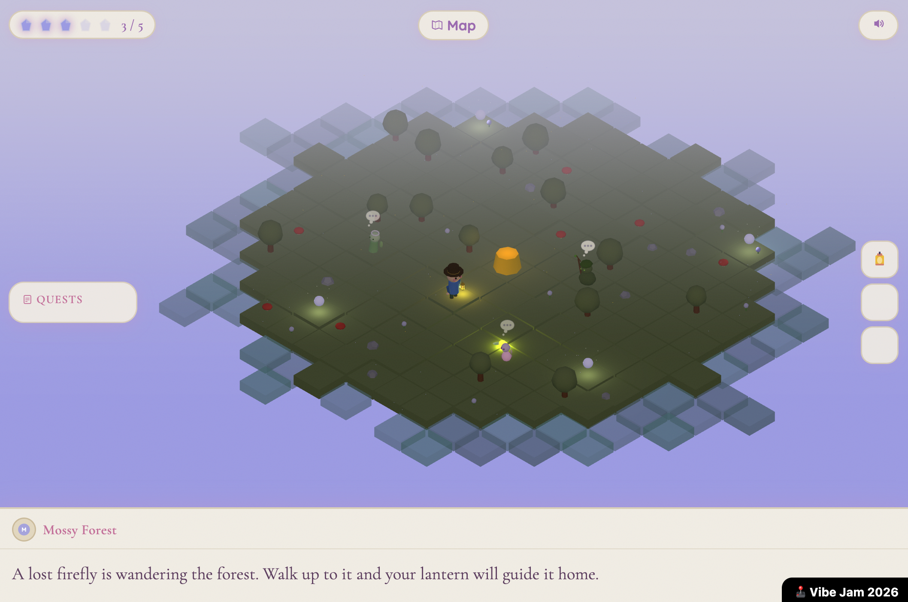

# Lantern Isle: Guardian Star

> *A hand-crafted cozy adventure where kindness is the key — help five islands of charming characters earn back their crystal shards, restore ancient shrines, and piece together the bittersweet mystery of why the Guardian Star went dark. Made for VibeJam 2026*

---

## About

You are the Lantern Bearer — a wanderer who arrives at a fading archipelago the night the Guardian Star went dark. Guide your chibi adventurer across **5 hand-crafted islands**, helping islanders, collecting crystal shards, and awakening ancient shrines to restore light to the world.

Some shards are waiting to be found. Others are earned by helping the people who need you.

---

## How It Works

Each island holds **5 crystal shards**. Explore to find some of them, and help the islanders with their requests — find a lost firefly, fetch a fallen wind chime, gather cherry petals — to earn the rest. On later islands, an elder's quest opens only after you've helped their neighbors.

Bring all 5 shards to the shrine at the island's heart. The shrine awakens with a beam of light and unlocks the next island on the world map.

Islands, in order: **Mossy Forest → Sunflower Beach → Sakura Cove → Crystal Cave → Lavender Highlands**

---

## Features

- **5 distinct biomes** — unique sky colors, terrain palettes, fog, flora, and characters per island
- **Quest-gated crystals** — some shards are free to find; others appear only after you help an islander
- **Ambient motion** — collectibles glow so you know what to pick up; everything else bobs gently
- **Procedural audio** — generative music and sound effects per island, zero audio files
- **Explore Mode** — unlocks every island so you can jump anywhere from the map
- **Mobile ready** — tap where you want to walk

---

## Controls

| Input | Action |
|-------|--------|
| WASD / Arrow Keys | Move |
| Walk up to a character or item | Talk / pick up |
| Any key | Advance dialogue |
| Tab or Map button | Open world map |
| M / Tab / Escape | Close world map |

Mobile: touch and hold where you want to walk; tap to advance dialogue.

---

## Tech

- **Three.js** r160 — ES modules via CDN, no build step
- **Isometric camera** — `OrthographicCamera` for a classic 2.5D perspective
- **Procedural terrain** — per-island tile shapes with deterministic hash-based decoration
- **Web Audio API** — fully generative music and SFX, no audio files
- **Canvas 2D** — world map, thought bubbles, water shimmer
- **GitHub Pages** — instant deploy, zero backend

---

Built for [VibeJam 2026](https://vibej.am/2026)
